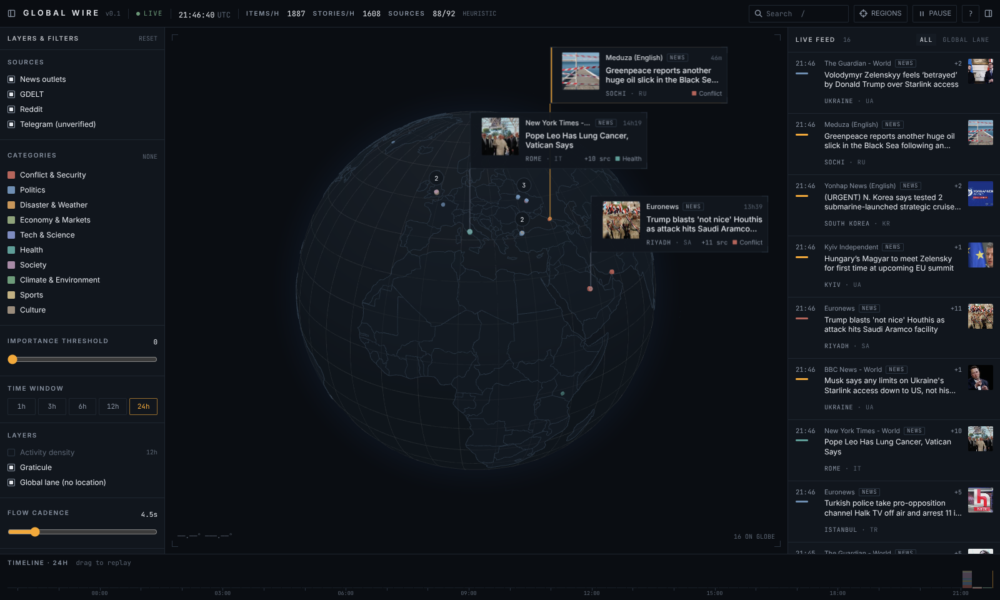

# GLOBAL WIRE — real-time news globe

A calm, continuous flow of world news on an interactive 3D globe. Stories from 60+ verified outlet feeds, GDELT,
Reddit and public Telegram channels are geolocated to **where they happen**, clustered across outlets, scored, and
released onto the globe at a steady cadence — each marker grows a thin leader line to a compact card.



## Quick start

Requirements: Node 20+ (22 recommended), pnpm 9+, Docker (for Postgres).

```bash
pnpm install
pnpm dev
```

`pnpm dev` creates `.env` from `.env.example` if missing, starts Postgres with `docker compose`, waits for it to be
healthy, applies migrations, downloads the GeoNames gazetteer on first run (~3 MB), and starts both apps:

| What | URL |
| --- | --- |
| Web app | http://localhost:5173 |
| API / SSE | http://localhost:8787 (`/stream`, `/api/*`) |
| Source health | http://localhost:8787/admin/sources |

No Docker? Point `DATABASE_URL` in `.env` at any Postgres 14+ and run `GW_SKIP_DB=1 pnpm dev`.

### Optional credentials (`.env`)

| Variable | Effect when set | Without it |
| --- | --- | --- |
| `ANTHROPIC_API_KEY` | LLM location fallback, categorisation and importance hints (batched, cached per item hash) | Offline gazetteer + keyword classifier only (top bar shows `HEURISTIC`) |
| `REDDIT_CLIENT_ID` / `REDDIT_CLIENT_SECRET` / `REDDIT_USER_AGENT` | Official OAuth API, `new` + `rising`, ranked by upvote velocity | Public `rising` RSS (no scores → nominal velocity) |
| `IMAGE_PROXY_SECRET` | Signs `/img` proxy URLs | Insecure dev default |
| `ADMIN_TOKEN` | Protects `/admin/*` (`?token=` or `x-admin-token`) | Admin is open |

## Using it

- **Drag** to rotate, **scroll** to zoom, **double-click** to zoom into a region. The globe slowly auto-rotates when idle.
- **Click** a card, marker or feed entry to open the story drawer (all outlets covering it, location map, geolocation
  confidence, engagement stats). Every link opens the original publisher — the app never shows full article text.
- **Right-click** a card or feed entry: pin (never decays), mute outlet / source type / category / region.
- **Timeline**: drag across the 24 h histogram to replay what appeared when; *Back to live* returns.
- **Regions** menu: fly to presets (Europe, Middle East, East Asia, South Asia, Americas, Africa, Oceania, Greece) or
  enter **focus mode** — only stories inside the region are released, everything else dims.
- Filters, mutes, pins, cadence and panel state persist in `localStorage`.

| Key | Action |
| --- | --- |
| `Space` | Pause / resume the flow |
| `F` | Focus mode on the region in view (again to exit) |
| `/` | Search |
| `[` / `]` | Toggle filters / live feed |
| `Esc` | Close drawer · reset view |
| `?` | Shortcut sheet |

On phones the globe is full-screen and the feed/filters live in a bottom sheet.

## Configuration

- **`config.yaml`** — every tunable in one place: cadence, jitter, max visible cards, card hold time, dot TTLs,
  queue-jump thresholds, clustering thresholds, score weights, poll intervals, velocity thresholds, LLM model/batch/budget.
  Restart the server to apply.
- **`sources.yaml`** — every source (`type`, `name`, `url`/`handle`/`query`, `region`, `country`, `lang`, `weight`,
  `enabled`, optional `intervalSec`, `minVelocity`). **Hot-reloaded**: add or disable sources without a restart.

```yaml
sources:
  - { type: news, name: "BBC News - World", url: "https://feeds.bbci.co.uk/news/world/rss.xml", region: global, country: GB, lang: en, weight: 1.0 }
  - { type: reddit, name: "r/worldnews", handle: worldnews, region: global, weight: 0.55, minVelocity: 2.0 }
  - { type: telegram, name: "Meduza Live", handle: meduzalive, region: europe, lang: ru, weight: 0.5, minVelocity: 60 }
  - { type: gdelt, name: "GDELT", region: global, weight: 0.4 }
```

`country` is the outlet's home country and is only used as a tie-breaker when a place name is ambiguous — never as the
story's location.

## Architecture

```
apps/
  server/   Fastify + TypeScript. Ingestion workers, pipeline, release flow, SSE, image proxy, admin.
  web/      Vite + React + TypeScript, globe.gl (Three.js), Zustand, Tailwind, Framer Motion.
packages/
  shared/   Types shared by both (Item, ClusterView, StreamEvent, categories, regions).
```

**Pipeline** — `ingest → normalise → enrich → geolocate → classify → cluster → score → release queue → stream`

| Stage | Module | Notes |
| --- | --- | --- |
| Ingest | `server/src/ingest/{rss,gdelt,reddit,telegram}.ts`, `sources/scheduler.ts` | Per-source schedule, exponential backoff with jitter, `Retry-After`, robots.txt, health tracking |
| Normalise | `ingest/normalise.ts` | One `Item` shape; canonical URLs; snippet ≤ 200 chars; future dates clamped |
| Enrich | `pipeline/og.ts`, `routes/img.ts` | Open Graph (`<head>` only); images fetched once, resized to WebP thumbnails, cached on disk, served via signed `/img` URLs |
| Geolocate | `geo/gazetteer.ts`, `pipeline/llm.ts` | GDELT coordinates → offline GeoNames (cities ≥15k, countries, admin-1) → LLM fallback. Stores place, country, lat/lon, precision, confidence, method |
| Classify | `pipeline/classify.ts` (+ LLM) | 10 categories + breaking detection |
| Cluster | `pipeline/cluster.ts`, `flow/store.ts` | Unigram+bigram title similarity, location proximity and time window; same-URL merge; lead = highest-weight outlet |
| Score | `pipeline/score.ts` | Outlets in cluster, source weight, engagement velocity, breaking, category weight, recency (+ LLM hint) |
| Flow | `flow/engine.ts` | Per-session release queue: highest score first, jittered cadence, breaking/high scores jump the queue, cluster growth updates the card in place |
| Stream | `routes/stream.ts` | SSE: `init` (current visible state) then `release` / `update` / `stats` |

Postgres (Drizzle, migrations in `apps/server/drizzle/`) stores items, clusters, source health, the LLM cache and the
OG cache. On boot the server reloads the last 48 h so the globe is populated immediately after a restart.

### HTTP API

| Route | Purpose |
| --- | --- |
| `GET /stream?session=&filters=` | SSE flow (filters = base64url JSON `FlowFilters`) |
| `POST /api/session/:id/filters` | Update a session's release filters (focus, mutes, pause, cadence…) |
| `GET /api/cluster/:id` | Full cluster view |
| `GET /api/clusters?from&to` | Clusters first seen in a window (timeline replay) |
| `GET /api/timeline?hours&bucketMin` | Histogram buckets by category |
| `GET /api/density?hours` | Points for the hex-bin density layer |
| `GET /api/search?q=` | Search recent stories |
| `GET /api/outlets` | Outlets for the filter panel |
| `GET /admin/sources[.json]` | Source health: status, last fetch, counts, errors; `POST /admin/sources/:id/fetch` forces a poll |
| `GET /health` | Liveness |

## Development

```bash
pnpm test          # vitest: geolocation, clustering/dedupe, scoring, flow, parsers
pnpm typecheck
pnpm build         # builds the web app; the server serves apps/web/dist when present
pnpm db:generate   # new migration after editing apps/server/src/db/schema.ts
pnpm geo:download  # (re)download GeoNames data
```

Production: `pnpm build`, then `pnpm --filter @gw/server start` serves the API and the built web app on one port.

See **DECISIONS.md** for defaults chosen, dropped feeds and known limitations.
